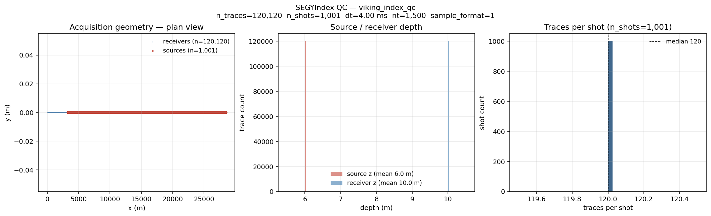
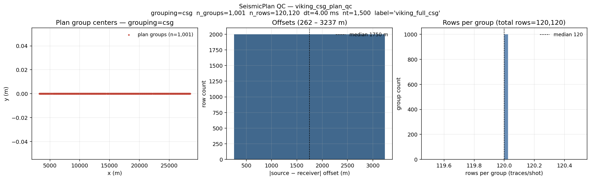
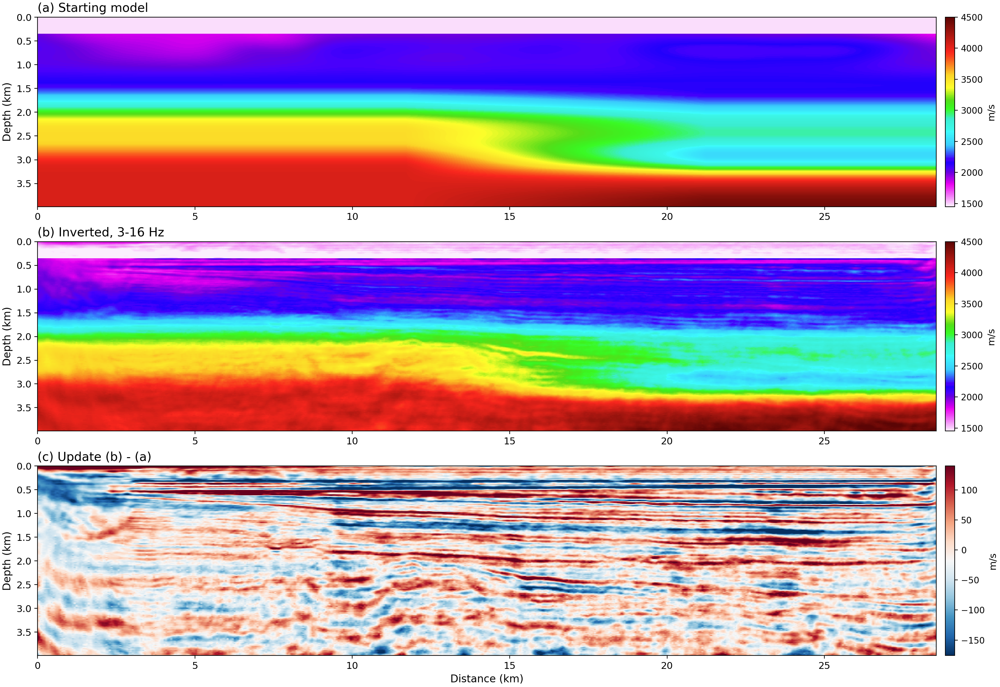
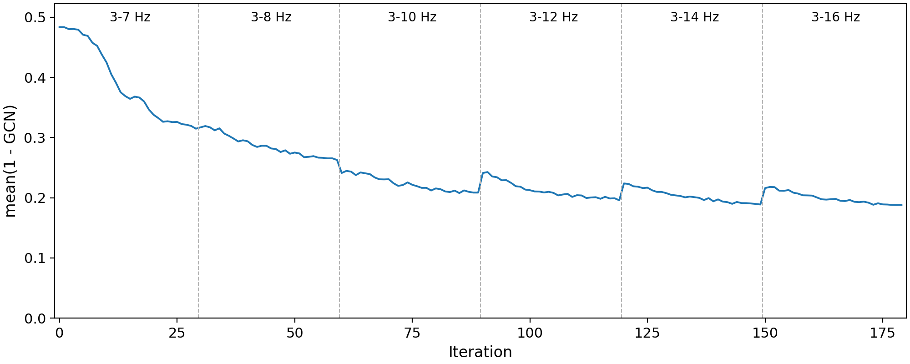

# Viking 2-D — frequency-selection FWI from the raw SEG-Y

Inverts the **Mobil AVO Viking Graben (line 12)** pre-stack data with the
sweep-tasks CLI, from the public download to an inverted velocity model. The
inversion is frequency-selection FWI (Tromp & Bachmann 2019): every shot
radiates its own frequencies continuously, all 1001 shots go into one forward
per iteration, and the misfit needs no source wavelet. The walkthrough assumes
**one workstation with one GPU**; [§ Running on a cluster](#running-on-a-cluster-optional)
at the end gives the sbatch template that runs the same steps.

```
download → build-index → build-plan → extract-coeff (6 bands) → sweep-tasks run
             (Step 1)      (Step 2)        (Step 4)                (Step 5)
```

Every file this needs is either downloaded in Step 0 or written by an earlier
step. The two files in this repository it uses are
[`examples/tasks/field/viking/pipeline_config.yaml`](https://github.com/DeepWave-KAUST/sweepx/blob/main/examples/tasks/field/viking/pipeline_config.yaml)
(Steps 1-2) and
[`examples/tasks/field/viking/viking_freqsel_allteeth.yaml`](https://github.com/DeepWave-KAUST/sweepx/blob/main/examples/tasks/field/viking/viking_freqsel_allteeth.yaml)
(Step 5).

## Visual tour — what each step produces

| Step | Product | Visual |
|---|---|---|
| 1 `build-index` | SEG-Y per-trace catalog (3-panel geometry QC) |  |
| 2 `build-plan`  | Grouped plan of all 1001 shots (3-panel QC)   |  |
| 5 `sweep-tasks run` | Inverted vp, 6 bands from 3-7 Hz to 3-16 Hz |  |

---

## Prerequisites

1. **sweepx installed**, which brings the solver along and puts the
   `sweep-tasks` command used below on your PATH, and **a checkout of this
   repository** for the two example files:

   ```bash
   git clone https://github.com/DeepWave-KAUST/sweepx.git $HOME/sweepx
   pip install -e "$HOME/sweepx[segy]"
   export SWEEPX=$HOME/sweepx
   ```

2. **One CUDA-capable GPU** with at least 16 GB. Sanity check:

   ```bash
   python -c "import torch; print(torch.cuda.is_available(), torch.cuda.get_device_name(0))"
   ```

3. **Working directory.** Pick one writable folder for the whole
   pipeline; the doc and both example files use `$VIKING_HOME` everywhere.
   About 8 GB free is enough (SEG-Y 750 MB, six coefficient shards of
   0.96 GB each, run outputs ~0.6 GB).

   ```bash
   export VIKING_HOME=$HOME/viking          # change to taste
   mkdir -p $VIKING_HOME/{raw,run}
   ```

   - `$VIKING_HOME/raw` holds the downloads (SEG-Y and starting model).
   - `$VIKING_HOME/run` holds the index, the plan, the shards and the FWI run.

---

## Step 0 — Download the public dataset

The data set used to be served by the SEG open-data S3 bucket
(`open.source.geoscience/open_data/Mobil_Avo_Viking_Graben_Line_12/`), which stopped
serving anonymous downloads in 2026. Its data files are re-hosted on Zenodo,
[doi:10.5281/zenodo.23481108](https://doi.org/10.5281/zenodo.23481108), with a second copy
in the `viking_graben_line12/` folder of the Hugging Face dataset
[shaowinw/seismic-benchmark-models](https://huggingface.co/datasets/shaowinw/seismic-benchmark-models).
The data are in the public domain (terms of use on the data set's
[SEG wiki page](https://wiki.seg.org/wiki/Mobil_AVO_viking_graben_line_12)); cite Keys and
Foster (1998), [doi:10.1190/1.9781560802082.ch1](https://doi.org/10.1190/1.9781560802082.ch1).
The same folder holds the FWI starting model used in Step 3.

```bash
cd $VIKING_HOME/raw

ZENODO=https://zenodo.org/records/23481108/files
HF=https://huggingface.co/datasets/shaowinw/seismic-benchmark-models/resolve/main/viking_graben_line12
get() { curl -fL -O "$ZENODO/$1" || curl -fL -O "$HF/$1"; }   # Zenodo first, then Hugging Face

# What this example needs.
get seismic.segy                   # pre-stack SEG-Y, 750 MB
get viking_initial_vp_12.5m.npy    # FWI starting model (Step 3), 5.8 MB

# Optional material of the original release.
get FarField.dat             # far-field source signature (ASCII, dt = 4 ms)
get FarField.jpg             # plot of the far-field signature
get mobil_wellogs.tar        # well logs (LIS)
get README.txt
get sufirst.job              # Seismic Unix: SEG-Y -> SU, print headers
get TERMS_OF_USE.txt
```

The bucket served the well logs gzip-compressed as `mobil_wellogs.tar.gz`; the copy is that
archive decompressed. Two more files of the original distribution are under copyright and
are not re-hosted; the Internet Archive keeps them:
[well-log plots](https://web.archive.org/web/20250527002516/https://s3.amazonaws.com/open.source.geoscience/open_data/Mobil_Avo_Viking_Graben_Line_12/Mobil_migration_well_logs.pdf)
and the [front matter of SEG Open File Publication No. 4](https://web.archive.org/web/20250527010149/https://s3.amazonaws.com/open.source.geoscience/open_data/Mobil_Avo_Viking_Graben_Line_12/284E_frontmatter.pdf).

Check the two files the example needs:

```bash
sha256sum -c <<'EOF'
64cbb49796b940717c57cddf5c7e0130b56df7061009a770565bdd0978cfccf3  seismic.segy
ffaa4bb07d9a91fe475e4ecee5232a9b977a1f57d5966e2aaee55e069aa2dea6  viking_initial_vp_12.5m.npy
EOF
ls -l seismic.segy viking_initial_vp_12.5m.npy   # 749,552,400 and 5,849,728 bytes
```

The SEG-Y byte count is not approximate — it is exactly what the headers imply,
so it doubles as an integrity check:

```
3600 + 120120 x (240 + 1500 x 4) = 749,552,400
^      ^         ^     ^
|      |         |     samples x 4 bytes (IBM float)
|      |         trace header
|      trace count
textual + binary file header
```

The textual header is a blank SEG-Y template — no client, line or crew filled
in — so every acquisition fact below comes from the binary and trace headers,
not from the reel stationery.

### What's in `seismic.segy`

| Field | Value |
| --- | --- |
| Trace count | 120,120 (1001 shots × 120 channels) |
| Samples / trace | 1500 |
| Sample interval | 4 ms |
| Record length | 6.0 s |
| Sample format | 1 (IBM 32-bit float) |
| FFID range | 3 to 1003 |
| Shot interval | 25 m (nominal; four gaps of 75-100 m) |
| Group interval | 25 m |
| Offset range | -262 m (near) to -3,237 m (far) |
| Source x | 3,237 to 28,512 m |
| Receiver x | 0 to 28,250 m |

`sy = gy = 0` for every trace — the line is genuinely 2-D in x. SEG-Y
coordinate scalar = 1 (so `sx, sy, gx, gy` are already metres) and
coord-units = 3 (m). **Source / receiver depth bytes are zero**, so
Step 1 below injects the Viking acquisition constants: airgun array at
**6 m**, streamer at **10 m**.

---

## Step 1 — `sweep-tasks build-index`

Scans every SEG-Y trace header in parallel and writes a small per-trace
catalog. Run **once**; the same index serves every plan you build later.
Steps 1 and 2 read their settings from one pipeline config, one section per
command:

```bash
sweep-tasks build-index --config $SWEEPX/examples/tasks/field/viking/pipeline_config.yaml
```

(`sweep-tasks init viking -o viking.yaml` writes the same two sections plus
sections for the wavelet tools, which this example does not use.) Or,
equivalently, all-CLI:

```bash
sweep-tasks build-index \
    --segy-root  $VIKING_HOME/raw \
    --glob       'seismic.segy' \
    --out        $VIKING_HOME/run/viking_index.npz \
    --num-workers 8 \
    --source-depth-m   6.0 --receiver-depth-m 10.0 \
    --progress
```

With `--num-workers 8` the scan itself takes about half a second on Viking;
the command is done in seconds. (The `-n N` MPI shortcut covered in
[`docs/tasks/cli_workflow.md`](../../cli_workflow.md) is for much larger
3-D surveys — Viking does not need it.)

**Console output (measured on Viking)**

```
[build-index] scanning 1 SEG-Y files under /…/viking/raw (glob='seismic.segy'; threads=8)
  scanned seismic.segy  (file_id=0, traces=120120)
[build-index] scan complete: 120,120 traces across 1 files, dt=0.004s nt=1500, wall=0.5s
[build-index] wrote /…/viking_index.npz (0.3 MB)
[build-index] QC PNG -> /…/viking_index_qc.png
```

**Outputs**

- `$VIKING_HOME/run/viking_index.npz` (~300 KB) — per-trace `file_id`,
  `byte_offset`, `shot_id`, `receiver_id` and positions `sx_m/sy_m/sz_m`,
  `rx_m/ry_m/rz_m` in metres; `sz_m` and `rz_m` are constant at the injected
  6 m / 10 m.
- `viking_index_qc.png` (~100 KB) — 3-panel acquisition geometry
  preview (pass `--no-qc-png` to skip): plan view (sources red, receivers
  blue, both on one track along x), source and receiver depth histograms
  (sharp peaks at the injected 6 m / 10 m), and the per-shot trace count
  (a flat 120 traces × 1001 shots).

Verify programmatically with:

```bash
python -c "from sweepx.io.segy_index import SEGYIndex; \
           idx=SEGYIndex.load('$VIKING_HOME/run/viking_index.npz'); \
           print(idx.n_traces, idx.n_shots, idx.dt_s, idx.n_samples); \
           print(float(idx.sx_m.min()), float(idx.sx_m.max()))"
# 120120 1001 0.004 1500
# 3237.0 28512.0
```


---

## Step 2 — `sweep-tasks build-plan`

Groups the index into a `seismic_plan_v1` npz that declares **exactly which
trace bytes the inversion will read**. Here the plan is every trace, grouped
by shot (common-shot gathers, CSG):

```bash
sweep-tasks build-plan --config $SWEEPX/examples/tasks/field/viking/pipeline_config.yaml
```

Or all-CLI:

```bash
sweep-tasks build-plan \
    --index    $VIKING_HOME/run/viking_index.npz \
    --grouping csg \
    --out      $VIKING_HOME/run/viking_csg_plan.npz \
    --label    "viking_full_csg"
```

The plan holds **1,001 CSG groups (shots) × 120 traces each = 120,120 rows**,
~8 MB. It carries the source and receiver coordinates of every row and the
byte offset of its trace, so Step 4 never parses a SEG-Y header again.
`build-plan` also writes `viking_csg_plan_qc.png` next to the npz (pass
`--no-qc-png` to skip): group centres, the offset histogram and the
rows-per-group histogram.

```bash
python -c "from sweepx.io.seismic_plan import SeismicPlan; \
           p=SeismicPlan.load('$VIKING_HOME/run/viking_csg_plan.npz'); \
           print(p.grouping, p.n_groups, p.n_rows)"
# csg 1001 120120
```


---

## Step 3 — Starting model (downloaded)

`viking_initial_vp_12.5m.npy` is a (320, 2285) float64 array of vp in m/s on
the 12.5 m model grid: 4.0 km deep and 28.56 km along the line. It is built
from three pieces:

* **0-1.2 km**: a smoothed first-arrival traveltime tomogram (50 m grid,
  upsampled), from 78,955 first-break picks over all 1001 shots;
* **below 1.7 km**: a smoothed velocity trend from the two wells on the line;
* **1.2-1.7 km**: a cosine taper between the two;
* **rows 0-27** (the top 350 m): water at 1485.6 m/s, the velocity measured
  from the direct arrival.

The first-break picks are not part of the public release, so the model cannot
be regenerated from `seismic.segy` alone; that is why it is distributed as a
file. The task YAML reads it with

```yaml
init_model:
  name: vp
  path: $VIKING_HOME/raw/viking_initial_vp_12.5m.npy
```

and each stage of Step 5 resamples it to its own grid.

---

## Step 4 — Extract the observed coefficients

Frequency selection replaces the shot gathers with the **coefficients** of a
handful of exact frequencies per shot. Every shot (a *node*) is assigned its
own comb of frequencies; the inversion fires all nodes at once, each radiating
only its comb, and compares the steady-state response with these coefficients.
The obs side is a discrete-time Fourier transform of the gathers that already
exist — no solver involved:

```bash
mkdir -p $VIKING_HOME/run/shards
#  lo hi  dh     dt      n_p    k_lo k_hi
while read lo hi dh dt n_p klo khi; do
  sweep-tasks extract-coeff --plan $VIKING_HOME/run/viking_csg_plan.npz \
      --dh-m $dh --dt $dt --min-fold 1 --node-stride 1 \
      --n-p $n_p --k-lo $klo --k-hi $khi \
      -o $VIKING_HOME/run/shards/coeff_${lo}_${hi}hz.npz
done <<'BANDS'
3 7  25    0.002  125000 750 1750
3 8  25    0.002  100000 600 1600
3 10 25    0.002  71450  429 1429
3 12 25    0.002  55584  334 1334
3 14 18.75 0.0015 60620  273 1273
3 16 18.75 0.0015 51292  231 1231
BANDS
```

`--dh-m` and `--dt` are the **solver** grid and time step of the stage that
reads the shard (the plan's own 4 ms record is read from the plan and handled);
`--n-p` is the length of the steady-state analysis window in solver steps, and
the comb is the DFT bins `f = k / (n_p · dt)` for `k_lo <= k <= k_hi`:

| band | stage grid | `--n-p` | window | `--k-lo` | `--k-hi` | bins | bin spacing |
|---|---|---|---|---|---|---|---|
| 3-7 Hz  | 25 m, 2 ms     | 125000 | 250.0 s | 750 | 1750 | 1001 | 0.0040 Hz |
| 3-8 Hz  | 25 m, 2 ms     | 100000 | 200.0 s | 600 | 1600 | 1001 | 0.0050 Hz |
| 3-10 Hz | 25 m, 2 ms     | 71450  | 142.9 s | 429 | 1429 | 1001 | 0.0070 Hz |
| 3-12 Hz | 25 m, 2 ms     | 55584  | 111.2 s | 334 | 1334 | 1001 | 0.0090 Hz |
| 3-14 Hz | 18.75 m, 1.5 ms | 60620 | 90.9 s  | 273 | 1273 | 1001 | 0.0110 Hz |
| 3-16 Hz | 18.75 m, 1.5 ms | 51292 | 76.9 s  | 231 | 1231 | 1001 | 0.0130 Hz |

How those numbers are derived — **bins are the currency**:

```
bins = bandwidth x window = bandwidth x (n_p * dt)        nodes per pool <= bins
```

This example gives **every one of the 1001 shots its own bin** ("all
teeth"): one pool holds the whole survey, and every iteration sees all
120,120 traces with no crosstalk between shots and no random batching. So each
band's window is `(k_hi - k_lo) / bandwidth = 1000 / bandwidth`: 250 s for the
4 Hz-wide lowest band, shrinking as the bands widen. `n_p` does not need to fit the 6 s record — the
obs transform integrates whatever the record has; `n_p` sizes the *synthetic*
window whose exact DFT bins the encoded sources occupy. With fewer bins than
nodes you would split the shots into pools (`n_pools`), which the inversion
visits in turn, or draw a random subset of nodes per iteration
(`random_batch`), much like shot mini-batching.

A shard is cut for one stage; the commands above give each stage exactly the
shard it asks for. The inversion rejects a shard whose `--dt` differs from the
stage's `dt_s`, or whose window and bins cannot supply the stage's comb. A
shard cut with a longer window (`--n-p` an integer multiple of
`probe_samples`) or a wider bin range is accepted and decimated, with a
`comb decimation` line in the log. `--dh-m` is not recorded in the shard, so
keep it equal to the stage's `dh_m` by hand: the shard stores source and
receiver positions as indices on that grid.

---

## Step 5 — Run the inversion

```bash
sweep-tasks run $SWEEPX/examples/tasks/field/viking/viking_freqsel_allteeth.yaml
```

The YAML takes every path from `$VIKING_HOME`, so it runs as it is; copy it
somewhere else first if you want to edit it. It writes to
`$VIKING_HOME/run/freqsel/viking_freqsel_allteeth/`.

This 2-D frequency-selection run uses one GPU: all 1001 shots already share
one forward, and spreading a run over several GPUs needs domain
decomposition, which is 3-D only. (`--nproc-per-node N` would start N
identical inversions writing the same run directory.)

What it does:

* **No wavelet enters the inversion.** The misfit is the per-node
  complex-cosine coherence `J = 1 - |<u,d>| / (|u| |d|)` on the steady-window
  DFT (`loss.kind: steady_gcn`), which is invariant to any per-node complex
  scale, so the airgun spectrum, the excitation delay and the sensor coupling
  all cancel.
* **One forward per iteration for all 1001 shots**, instead of one per shot.
  Each forward is long — a 20 s ring-up, 0.5 s of slack and the analysis
  window, e.g. 135,250 steps for the 3-7 Hz band — but it replaces 1001
  conventional forwards.
* **Six bands, 30 iterations each**, on a 25 m grid up to 3-12 Hz and an
  18.75 m grid for 3-14 and 3-16 Hz. The time step keeps the CFL number at
  0.44 for 5500 m/s. The grid stays at or below 25 m so the 6 m source and the
  10 m streamer remain in the top cell.
* **The model is a hash-encoded coordinate network** (`reparam:`): the network
  predicts a perturbation of the starting model with a 500 m/s scale, and its
  learning rate drops from 1.0 to 0.42 of `reparam.lr` across the bands
  (`inr_lr_scale`).
* **The water column is inverted too** (`water: false`), and vp is not
  bounded. To hold the water at 1485.6 m/s instead, replace `water: false`
  with `water: { seabed: 350.0, velocity: 1485.6 }`.

Three settings are worth understanding before editing anything:

* `steady_samples` (20 s in each stage's dt) — the continuous sources must
  ring up across the whole line before the analysis window opens:
  28.6 km / 1485.6 m/s = 19.2 s. The schema default (2500 steps) leaves a
  transient in the window here.
* `abcn: 50` — 1250 m of absorbing boundary on the 25 m grid and 937 m on the
  18.75 m grid, both above the 495 m wavelength at 3 Hz. A continuous wave in
  a leaky box builds standing waves that would not cancel between the
  transient obs and the steady-state synthetic.
* **Repeat every key in every stage's `frequency:` block.** A stage block
  *replaces* the global one wholesale — it is not merged — so an omitted key
  reverts to the schema default. The runner warns about a key the global block
  sets to a non-default value that a stage block leaves out; that covers every
  key in this YAML.

### What "good" looks like

Measured on one V100 (32 GB), running the
[sbatch template](#running-on-a-cluster-optional) as it is: the whole job took
**54 min** — index, plan and the six shards 2 min, the inversion 52 min
(16.7 s per iteration on average: 25.5 s in the 3-7 Hz band, 11.7 s in
3-12 Hz). Peak GPU memory was **9.7 GB**, in the first band. The shards take
5.8 GB on disk and the run directory 0.6 GB. Each band's setup runs partly on
the CPU before its first iteration; that took under a minute per band on this
node, while on a busier V100 node the first band alone took 12 min, so allow
for some spread.

The log should show, for every band, all 1001 shots in one pool and every
trace in the misfit:

```
[freqsel] stage 0: 1001 nodes, 120120 items, 1131 union cells, 1 pools, comb 3.0000-7.0000 Hz, nt=135250, dh=25.0, dt=0.002
[freqsel][rank0] stage 0 steady-state two-window check: median rel diff = 2.455e-06
[freqsel] s0 it    0 pool  0  mean(1-GCN)=0.48363  iter_s=25.7  peak_gb=9.72
...
[freqsel] s5 it   29 pool  0  mean(1-GCN)=0.18809  iter_s=12.8  peak_gb=5.63
```

* **items = 120,120**, the survey's trace count, in every band: every
  (shot, trace) pair is in the misfit. `union cells` is the deduplicated
  receiver table — the 120,120 traces need only 1131 recording positions.
* **two-window check** `<= 1e-2` — the runner extracts the synthetic
  coefficients twice, `slack_samples` apart; if they differ, the sources have
  not reached steady state and `steady_samples` must grow. Measured 2.5e-6 in
  the 3-7 Hz band and 0.9e-4 to 1.2e-4 in the others.
* **the misfit falls within every band.** `mean(1-GCN)` per band, first and
  last iteration:

  | band | 3-7 Hz | 3-8 Hz | 3-10 Hz | 3-12 Hz | 3-14 Hz | 3-16 Hz |
  |---|---|---|---|---|---|---|
  | first | 0.484 | 0.317 | 0.241 | 0.241 | 0.224 | 0.216 |
  | last  | 0.315 | 0.263 | 0.209 | 0.196 | 0.189 | 0.188 |

  A new band starts from the previous band's model but measures the misfit
  over a wider set of frequencies, so the value at a band boundary is not
  continuous. On another GPU the digits will differ (floating-point reduction
  order); the curve should stay within about 1 %.



The result is written to `inverted_vp.npy` in the run directory, on the last
band's 18.75 m grid (214 × 1524). Below, (a) is the starting model, (b) the
inverted model and (c) their difference, with the starting model resampled to
the 18.75 m grid:


The water column is inverted too. In this run its median velocity stays
between about 1480 and 1555 m/s down to about 190 m and decreases below that,
reaching 1249 m/s at 319 m (minimum 1177 m/s), a slow band roughly 100 m thick
above the 350 m seabed of the starting model. To hold the water at
1485.6 m/s instead, replace `water: false` with
`water: { seabed: 350.0, velocity: 1485.6 }`.

This run does not test how deep the data constrain the model. One way to find
out is to run the same YAML from a different starting model and see where the
two results agree.

---

## Reproducibility cheat sheet (single GPU, local)

```bash
# === one-time setup ========================================================
git clone https://github.com/DeepWave-KAUST/sweepx.git $HOME/sweepx
pip install -e "$HOME/sweepx[segy]"
export SWEEPX=$HOME/sweepx VIKING_HOME=$HOME/viking
mkdir -p $VIKING_HOME/{raw,run/shards}

# === Step 0: download (~760 MB) ============================================
cd $VIKING_HOME/raw
ZENODO=https://zenodo.org/records/23481108/files      # doi:10.5281/zenodo.23481108
HF=https://huggingface.co/datasets/shaowinw/seismic-benchmark-models/resolve/main/viking_graben_line12
for f in seismic.segy viking_initial_vp_12.5m.npy; do
  curl -fL -O $ZENODO/$f || curl -fL -O $HF/$f
done

# === Steps 1-2: index and plan =============================================
CFG=$SWEEPX/examples/tasks/field/viking/pipeline_config.yaml
sweep-tasks build-index --config $CFG
sweep-tasks build-plan  --config $CFG

# === Step 3: starting model — downloaded in Step 0 =========================

# === Step 4: coefficient shards ============================================
while read lo hi dh dt n_p klo khi; do
  sweep-tasks extract-coeff --plan $VIKING_HOME/run/viking_csg_plan.npz \
      --dh-m $dh --dt $dt --min-fold 1 --node-stride 1 \
      --n-p $n_p --k-lo $klo --k-hi $khi \
      -o $VIKING_HOME/run/shards/coeff_${lo}_${hi}hz.npz
done <<'BANDS'
3 7  25    0.002  125000 750 1750
3 8  25    0.002  100000 600 1600
3 10 25    0.002  71450  429 1429
3 12 25    0.002  55584  334 1334
3 14 18.75 0.0015 60620  273 1273
3 16 18.75 0.0015 51292  231 1231
BANDS

# === Step 5: FWI (6 bands x 30 iterations) =================================
sweep-tasks run $SWEEPX/examples/tasks/field/viking/viking_freqsel_allteeth.yaml
# one GPU: 2-D frequency selection does not run across several GPUs
```

---

## Running on a cluster (optional)

[`examples/tasks/sbatch/viking_freqsel.sbatch`](https://github.com/DeepWave-KAUST/sweepx/blob/main/examples/tasks/sbatch/viking_freqsel.sbatch)
runs Steps 1-5 in one SLURM job on one GPU. On a resubmit it skips Steps 1-4
when their output exists and does not repeat a finished inversion; an
unfinished inversion restarts from the first band. Do Step 0 first, activate the
environment that has sweepx (sbatch passes your shell's environment on to the
job), and export the two paths:

```bash
export VIKING_HOME=$HOME/viking SWEEPX=$HOME/sweepx
sbatch $SWEEPX/examples/tasks/sbatch/viking_freqsel.sbatch
```

The log goes to `viking_freqsel-<jobid>.out` in the directory you submit from.
Partition, account and GPU type are cluster-specific: pass them on the sbatch
command line (for example `--partition=…`, or `--gres=gpu:<type>:1` on clusters
that name GPU types).

---

## Other `sweep-tasks` tools for field data

This example uses four subcommands: `build-index`, `build-plan`,
`extract-coeff` and `run`. The CLI has more that a conventional (time-domain,
wavelet-based) workflow on the same plan would use; `sweep-tasks <command>
--help` documents each:

| Subcommand | What it does |
| --- | --- |
| `analyze-wavelet`    | rank-1 robust average of the direct arrival across shots |
| `estimate-wavelet`   | wavelet estimation by wave-equation fitting of the direct arrival |
| `convert-farfield`   | ASCII far-field signature (e.g. `FarField.dat`) → npz |
| `plot-wavelet-steps` | QC plot of the wavelet-estimation chain |
| `filter-image`       | depth-tapered z-axis low-cut for RTM images |

[`docs/tasks/cli_workflow.md`](../../cli_workflow.md) covers `build-index`,
`build-plan`, `run` with `from_plan`, `extract-coeff` and `filter-image` for
any dataset.

---

## See also

- [`docs/tasks/cli_workflow.md`](../../cli_workflow.md) — generic build-index /
  build-plan / run / extract-coeff reference (covers all datasets).
- [`examples/tasks/field/viking/`](https://github.com/DeepWave-KAUST/sweepx/tree/main/examples/tasks/field/viking) —
  the pipeline config and the task YAML used above.
- [`examples/tasks/sbatch/viking_freqsel.sbatch`](https://github.com/DeepWave-KAUST/sweepx/blob/main/examples/tasks/sbatch/viking_freqsel.sbatch) —
  the SLURM template.
- Tromp, J., and Bachmann, E. (2019), Source encoding for adjoint tomography,
  *Geophysical Journal International*, 218(3), 2019-2044.
