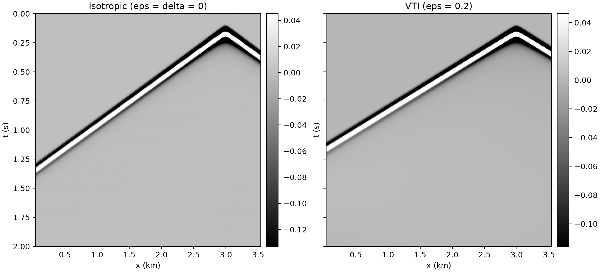
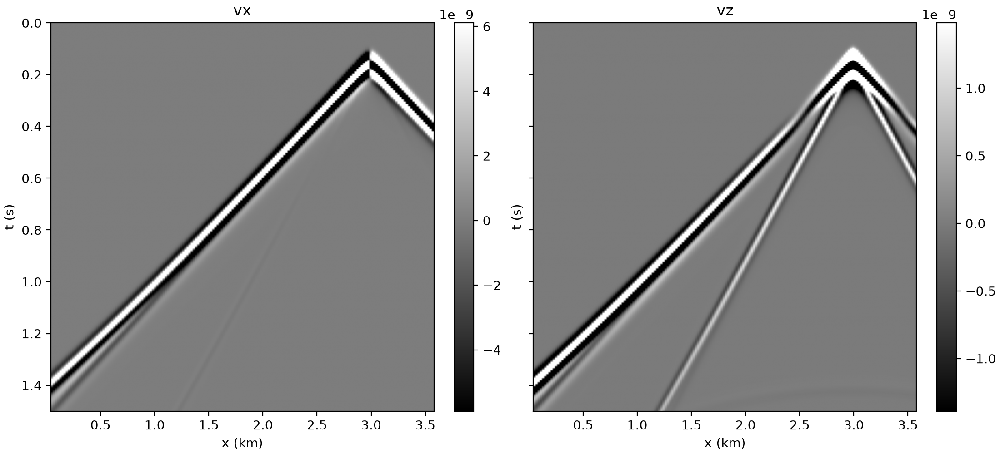

# Anisotropic and elastic

Every other example pins `equation: Acoustic` or `Acoustic3D` — two of the 39
equations sweep-solver 0.3.5 registers, and two of only three that take `vp`
alone. These two show the pattern for all the rest:

* **`models:` must list every model the equation declares**, by name, and the
  names are not guessable. Ask [15](introspect.md) rather than assume:
  `AcousticVTI` wants `[vp, epsilon, delta]`, `Elastic` wants `[vp, vs, rho]`,
  `ElasticTTI` wants eight. A missing or misspelt name is an error at setup,
  not a silent default.
* **`source_type` / `receiver_type` are per-equation too.** The acoustic `h1`
  (pressure) still applies to VTI because it is pseudo-acoustic, but the
  velocity-stress elastic equation has no `h1` at all. Get it wrong and the
  runner fails at setup with the full list of valid values.

Both build their models in memory, need no dataset, and run on `impl: eager`.

## 16 — VTI anisotropy

```bash
sweep-tasks run examples/tasks/synthetic/16_forward_anisotropic.yaml
```

A wavefront whose velocity depends on the direction it travels — which no
isotropic example can show. Thomsen's parameters are defined so that zero means
isotropy, so re-running with `epsilon` and `delta` both 0 is a clean control:

```bash
sweep-tasks run examples/tasks/synthetic/16_forward_anisotropic.yaml \
    --override task_id=aniso_iso \
    --override 'models=[{"name":"vp","constant":2500.0,"shape":[200,360]},
                        {"name":"epsilon","constant":0.0,"shape":[200,360]},
                        {"name":"delta","constant":0.0,"shape":[200,360]}]'
```



Same `vp`, same geometry: the VTI first break arrives earlier, and the gap
grows with offset. Measured on shot index 1 (x = 1.8 km) at the receiver at
x = 3.54 km, 1740 m offset, taking the first break as the first sample above
5 % of the trace maximum:

| | first break |
|---|---|
| isotropic, ε = δ = 0 | 787 ms |
| VTI, ε = 0.2 | 680 ms — ratio 1.157 |

The horizontal P velocity is `vp·sqrt(1 + 2ε)` = 1.183 `vp`. The ratio of the
two first-break times is lower because both carry the same constant of about
91 ms — the 0.15 s wavelet delay, less how early the threshold pick fires —
and not because of the ray, which with the source at 40 m and the receivers at
80 m is within 1.3° of horizontal. Take the constant out and the speed-up is
there: a straight-line fit of peak time against distance over offsets of
800 m and more gives 2501 m/s isotropic and 2955 m/s VTI, a ratio of 1.181.
The farther the trace, the less the constant matters: the 2960 m trace of shot
index 2, the one plotted above, reads 1.167 from first breaks alone. `delta`
controls the near-vertical curvature (the NMO velocity `vp·sqrt(1 + 2δ)`)
rather than the horizontal asymptote.

**Reference (`--override device=cpu`, 8 threads): 37.6 s**, record
`(3, 2000, 176, 1)`.

## 17 — elastic: P and S in one record

```bash
sweep-tasks run examples/tasks/synthetic/17_forward_elastic.yaml
```

An explosive source in the elastic equation is equal normal stresses,
`source_type: [sxx, szz]`, and the natural receivers are the two
particle-velocity components `[vx, vz]` — so the record's last axis is 2.



Two arrivals where the acoustic examples have one: the fast P and, steeper,
the S wave. On shot index 2 (x = 3.0 km, plotted above), the P envelope peaks
at 590 ms and the S on `vz` at 917.5 ms at 1000 m offset, and at 762 ms and
1215 ms at 1400 m. Take the 0.15 s wavelet delay off both and the ratio is
1.74 at each — `vp/vs` (1.73) to within the picks; across offsets of 0.6–1.6 km
on all three shots it stays between 1.73 and 1.76, while the raw ratio of the
two times drifts from 1.47 to 1.61. It matches `vp/vs` at every offset because
`vs = vp/√3` holds at every depth here: the two gradients are proportional, so
P and S follow the same ray.

The S exists only because of those gradients. An explosive source (`sxx` =
`szz`) radiates no S in a homogeneous solid: rerun with all three models
constant and, beyond 1.1 km offset, `vz` in the window where S would arrive
stays below 5e-4 of the P peak. Around the P arrival `vx` carries 4–7× the
amplitude of `vz` at offsets of 1.0–1.4 km (17× at 600 m, 3× at 1.6 km): the P
ray arrives at a shallow angle, so its particle motion is mostly horizontal.

Set `physics.free_surface: true` and a third, slower, dispersive arrival
appears — the Rayleigh wave — which does not exist in an acoustic model at all.

There is no `pml_type:` in the file, on purpose. Elastic is solved on a
staggered grid, so its PML is the staggered `cpmls`; left unset, every equation
gets the PML it ships, and naming another is refused.

**Reference (`--override device=cpu`, 8 threads): 61.8 s**, record
`(3, 3000, 178, 2)`.
